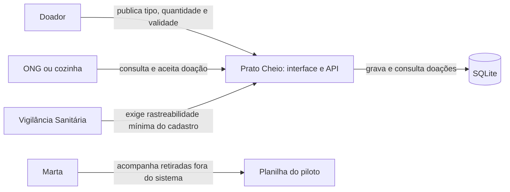

Pergunta: Quem participa do fluxo de publicação e aceite e onde os dados ficam?
Decisão que sustenta: Manter o fluxo mínimo da Análise e persistir em SQLite nesta unidade (ADR 0001).
Situação: retrato da main no commit 8fb77700de4bab4b73e576b6c7c84e2e4078ac5b

A seta da Vigilância representa requisito da Análise, não uma integração automática. O sistema não registra retirada; Marta a acompanha externamente no piloto.
