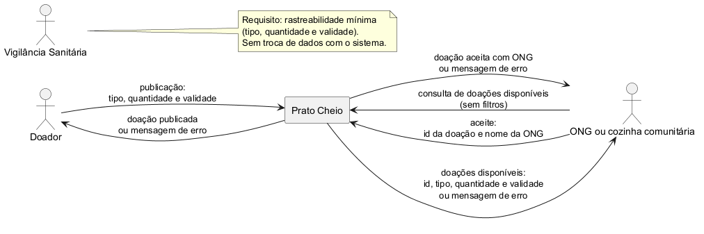
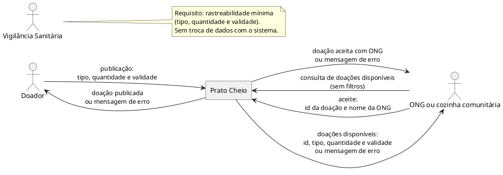

# Diagrama de contexto

O diagrama representa a fronteira do Prato Cheio no fluxo implementado de publicação, consulta e aceite. O produto aparece como uma única caixa; doador e ONG ou cozinha comunitária trocam as informações indicadas nas setas.

Fonte editável em PlantUML (para atualizar a imagem, veja [como gerar os diagramas](../../README.md#diagramas-do-projeto)):

A Vigilância Sanitária aparece como origem de uma exigência da Análise, acompanhada de uma nota e sem seta de fluxo de informação. O sistema usa SQLite como persistência interna, que não é um sistema externo do contexto. Marta acompanha as retiradas em uma planilha externa no piloto, sem integração com o Prato Cheio; a retirada não é registrada pelo produto.

As seis setas têm rótulos e correspondem aos fluxos da interface e da API descritos em [`src/app.js`](../../src/app.js) e [`public/app.js`](../../public/app.js): publicação (`POST /api/doacoes`), consulta (`GET /api/doacoes`) e aceite (`POST /api/doacoes/:id/aceitar`, com o nome da ONG no corpo).

Os rótulos destacam as informações usadas nesses fluxos. Na API, a publicação e o aceite retornam a doação com as sete colunas do [modelo de dados](dados.md); a consulta retorna uma lista desses objetos, e falhas retornam uma mensagem em `erro`. A interface apresenta a confirmação ou o erro à pessoa e exibe tipo, quantidade e validade na lista.
