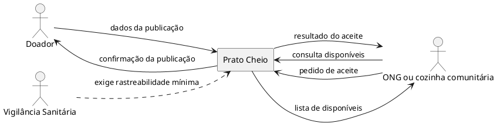

# Diagrama de contexto

**Pergunta:** quem participa do fluxo de publicação e aceite e onde os dados ficam?

**Decisão que sustenta:** manter o fluxo mínimo da Análise e persistir os dados em SQLite, como banco interno do produto (ADR 0004).

A Vigilância Sanitária aparece como origem de uma exigência da Análise, não como integração automática com o produto. O sistema usa SQLite como persistência interna, que não é um sistema externo do contexto. Marta acompanha as retiradas em uma planilha externa no piloto, sem integração com o Prato Cheio; a retirada não é registrada pelo produto.

O diagrama tem quatro elementos e todas as setas têm rótulos. As seis mensagens do doador e da ONG correspondem aos fluxos da interface e da API descritos em `src/app.js` e `public/app.js`.
