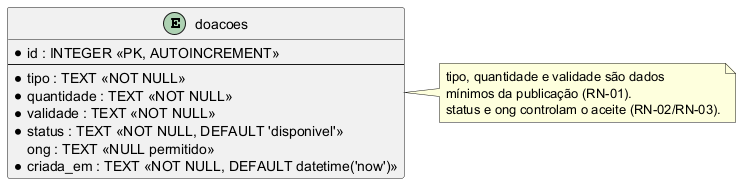
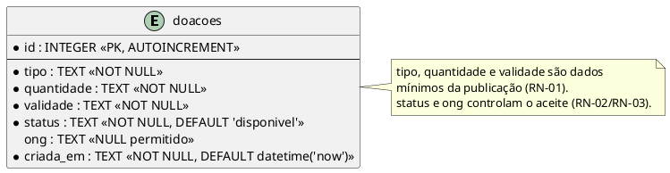

Pergunta: Quais dados são persistidos e como representam o aceite exclusivo de uma doação? 
Decisão que sustenta: Cadastro mínimo e aceite atômico condicionado ao status (D1 e D2; ADRs 0001 e 0002; RN-01 a RN-03). 
Situação: retrato da main no commit 5d9d40f0b74b03324213eeb4dedf5e9d99da484d; schema e operações conferidos, sem alteração neste fechamento.

# Modelo de dados

**Fonte:** schema criado por `migrar()` em [`src/db.js`](../../src/db.js); operações em [`src/repositorio.js`](../../src/repositorio.js). O modelo representa o que está implementado, com as regras de negócio da [Análise](../analise.md).

Fonte editável em PlantUML (para atualizar a imagem, veja [como gerar os diagramas](../../README.md#diagramas-do-projeto)):

`src/db.js` cria somente a tabela `doacoes`. Não existem relacionamentos entre tabelas: `ong` é uma coluna de texto, não uma chave estrangeira. Os atributos representados são exatamente os sete do schema. `id` é chave primária autoincremental; `tipo`, `quantidade`, `validade`, `status` e `criada_em` são `NOT NULL`; `ong` aceita `NULL`. O status padrão é `disponivel` e `criada_em` recebe `datetime('now')`.

Na inserção, o repositório grava tipo, quantidade e validade; o banco fornece os padrões de `status`, `ong` (nulo) e `criada_em`. Antes do aceite, portanto, `status='disponivel'` e `ong=NULL`. O `aceitar(id, ong)` de `src/repositorio.js` executa um único `UPDATE` condicionado a `id` e `status='disponivel'`: após o aceite, `status='aceita'` e `ong` recebe o nome informado. A camada de negócio recusa uma doação já aceita na consulta prévia; se duas requisições consultarem o estado disponível, o `UPDATE` condicional garante que apenas uma altere a linha. O repositório não retorna linha para a outra tentativa, e a camada de negócio a recusa.

| Momento | `status` | `ong` | Efeito no fluxo |
|---|---|---|---|
| Após a publicação | `disponivel` | `NULL` | A doação aparece na consulta de disponíveis. |
| Após o primeiro aceite | `aceita` | Nome da ONG que aceitou | A doação sai da lista de disponíveis e fica associada à ONG. |
| Tentativa de segundo aceite | Permanece `aceita` | Mantém o nome da primeira ONG | A API recusa a tentativa; o `UPDATE` condicional também impede sobrescrever o primeiro aceite em caso de concorrência. |

Os dados ligados às regras de negócio são **tipo**, **quantidade** e **validade** (publicação obrigatória) e **status** e **ong** (disponibilidade e aceite exclusivo). Não há tabelas ou colunas implementadas para cadastro de doador, retirada, endereço ou histórico.

As restrições do desenho pertencem ao schema. `validade` é `TEXT`, e o formato `AAAA-MM-DD` e a existência da data são validados em `src/doacoes.js`, antes da gravação. `quantidade` também é texto (por exemplo, `10 porções`), sem unidade numérica separada. Não há `CHECK` limitando `status` a `disponivel`/`aceita`: esses são os estados usados pela aplicação. `ong` armazena o nome informado no aceite, sem cadastro ou autenticação de organizações.
