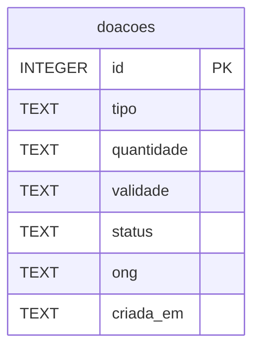

Pergunta: Quais dados de doação o SQLite armazena atualmente?
Decisão que sustenta: Cadastro mínimo e aceite atômico condicionados ao status (RN-01 a RN-03 da Análise).
Situação: retrato da main no commit 8fb77700de4bab4b73e576b6c7c84e2e4078ac5b

Retrato do schema definido em `src/db.js`: `id` usa `AUTOINCREMENT`; `tipo`, `quantidade`, `validade`, `status` e `criada_em` são `NOT NULL`; `ong` aceita `NULL`. `status` inicia como `disponivel`, `criada_em` usa `datetime('now')` e o aceite muda `status` para `aceita` e preenche `ong`. Há só uma tabela e nenhuma chave estrangeira. O diagrama não representa campos ainda não implementados.
