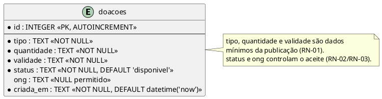

**Pergunta:** quais dados de doação são persistidos atualmente?\
**Decisão que sustenta:** cadastro mínimo e aceite atômico condicionado ao status (D1/D2; RN-01 a RN-03 da Análise; [ADR 0001](../adr/0001-aceite-atomico.md) e [ADR 0002](../adr/0002-validacao-dados-minimos.md)).\
**Situação:** retrato da main no commit `86bda88cee0564b0c4fd163e2f9f685959369bac`.

**Fonte:** schema criado por `migrar()` em `src/db.js`; operações em `src/repositorio.js`.

Fonte editável em PlantUML (para atualizar a imagem, veja [como gerar os diagramas](../../README.md#diagramas-do-projeto)):

`src/db.js` cria somente a tabela `doacoes`. Não existem relacionamentos entre tabelas: `ong` é uma coluna de texto, não uma chave estrangeira. Os atributos representados são exatamente os sete do schema. `id` é chave primária autoincremental; `tipo`, `quantidade`, `validade`, `status` e `criada_em` são `NOT NULL`; `ong` aceita `NULL`. O status padrão é `disponivel` e `criada_em` recebe `datetime('now')`.

Na inserção, o repositório grava tipo, quantidade e validade; o banco fornece os padrões de `status`, `ong` (nulo) e `criada_em`. Antes do aceite, portanto, `status='disponivel'` e `ong=NULL`. `aceitar(id, ong)` executa um único `UPDATE` condicionado a `id` e `status='disponivel'`: após o aceite, `status='aceita'` e `ong` recebe o nome informado. Um segundo aceite não altera a linha, porque o status já não satisfaz a condição; o repositório não retorna linha nesse caso.

Os dados ligados às regras de negócio são **tipo**, **quantidade** e **validade** (publicação obrigatória) e **status** e **ong** (disponibilidade e aceite exclusivo). Não há tabelas ou colunas implementadas para cadastro de doador, retirada, endereço ou histórico.

As restrições do desenho pertencem ao schema. `validade` é `TEXT`, e o formato `AAAA-MM-DD` e a existência da data são validados em `src/doacoes.js`, antes da gravação. `quantidade` também é texto (por exemplo, `10 porções`), sem unidade numérica separada. Não há `CHECK` limitando `status` a `disponivel`/`aceita`: esses são os estados usados pela aplicação. `ong` armazena o nome informado no aceite, sem cadastro ou autenticação de organizações. O diagrama contém uma entidade e uma nota, dentro do limite de nove elementos.
