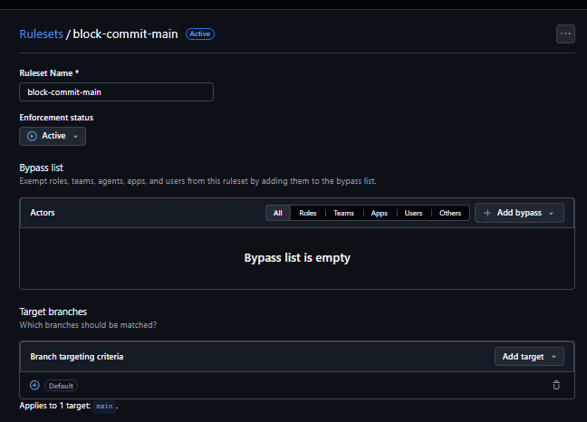

# Evidência de proteção da `main`

## Estado

A proteção da branch `main` está completamente configurada e ativa desde 19/09/2026.

O ruleset `block-commit-main` é aplicado à branch padrão `main` e possui a lista de bypass vazia.

## Controles ativos

- Todas as alterações entram por Pull Request.
- Cada Pull Request exige pelo menos uma aprovação.
- Novos commits invalidam aprovações anteriores.
- O envio mais recente exige aprovação de outro integrante.
- Todas as conversas precisam estar resolvidas antes do merge.
- A branch do Pull Request precisa estar atualizada com a `main` antes do merge.
- O check `build-e-testes` precisa passar antes do merge.
- A exclusão da branch `main` está bloqueada.
- Force push na branch `main` está bloqueado.
- Nenhum usuário, equipe, papel ou aplicativo possui permissão de bypass.

## Captura

A captura comprova que o ruleset `block-commit-main` está ativo, protege a branch `main` e não possui atores autorizados a ignorar suas regras.

## Repositório

- [`CodePenguinsCorp/prato-cheio`](https://github.com/CodePenguinsCorp/prato-cheio)
- [`Settings > Rules > Rulesets`](https://github.com/CodePenguinsCorp/prato-cheio/settings/rules)
