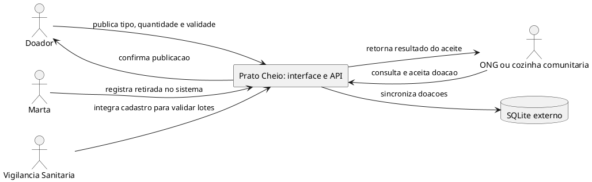

# Registro da revisão com IA de diagramas

## Geração inicial

Ferramenta: ChatGPT (modelo de linguagem usado nesta tarefa).

Prompt enviado: “Com base na descrição do caso Prato Cheio: doadores publicam excedentes, ONGs e cozinhas consultam e aceitam ofertas, Marta acompanha retiradas durante o piloto, e a Vigilância Sanitária exige rastreabilidade mínima. Gere uma primeira versão PlantUML de diagrama de contexto. Inclua o banco de dados e os participantes que considerar pertinentes.”

A resposta abaixo foi preservada como gerada, antes da comparação e das correções:

## Comparação com análise e repositório

A descrição candidata foi confrontada com `docs/analise.md`, especialmente RN-01 a RN-05, a história zero, os critérios CA-01 a CA-05, o experimento do piloto e as limitações da decisão de análise. A análise define publicar, listar e aceitar como fatia desta iteração e informa que retirada física não é registrada pelo produto. O registro de uso de IA em `docs/projeto.md` informa que a revisão humana da contribuição integrada continua pendente; portanto, este registro não declara aprovação humana.

| Trecho da geração inicial | Fonte que contradiz | Correção aplicada no diagrama final |
|---|---|---|
| `Marta --> PC : registra retirada no sistema` | `docs/analise.md`, seção “Hipótese e experimento”: Marta acompanha publicação, validade, aceite e confirmação da retirada em planilha, pois o sistema ainda não registra retirada. `public/app.js` implementa publicação, consulta e aceite; não registra retirada. | Marta não foi mostrada como ator que troca informação com o sistema. O texto de `docs/diagramas/contexto.md` explicita acompanhamento em planilha externa, sem integração. |
| `database "SQLite externo" as DB` e `PC --> DB : sincroniza doacoes` | `src/db.js` cria e conecta a tabela SQLite como persistência usada pelo produto; `src/repositorio.js` faz consultas e atualizações nessa conexão. Não há sistema externo nem sincronização. | SQLite não aparece como sistema externo no diagrama. O texto final o identifica como persistência interna. |
| `VS --> PC : integra cadastro para validar lotes` | `docs/analise.md`, seção “Conflitos de prioridade”, registra a exigência de rastreabilidade mínima e define tipo, quantidade e validade como obrigatórios. `src/app.js` e `public/app.js` não implementam integração com a Vigilância. | A Vigilância permanece no contexto, com a exigência em uma nota e sem seta para o sistema. Assim, o requisito não é representado como troca de dados ou integração automática. |

## Ajustes após a conferência do enunciado do Trabalho 2

A IA detalhou as informações nas seis setas do contexto: tipo, quantidade e validade na publicação; consulta sem filtros; dados das ofertas na listagem; identificador da doação e nome da ONG no aceite; confirmação ou mensagem de erro nas respostas. Também substituiu a seta de exigência da Vigilância por uma nota, preservando esse participante no contexto.

Os dois arquivos de diagramas agora começam com Pergunta, Decisão que sustenta e Situação, conforme a etapa 2 do enunciado. O retrato foi associado à main no commit `86bda88cee0564b0c4fd163e2f9f685959369bac`; os arquivos de implementação e a Análise não diferem entre esse commit e a branch de modelagem nesta conferência. O modelo de dados mantém as sete colunas, tipos, chave, nulabilidade e padrões do schema.

## Validação técnica — 22/10/2026

A IA executou `npm test`: os 15 testes passaram nos dois arquivos da suíte, incluindo aceite exclusivo e isolamento do banco. Os blocos PlantUML de contexto e dados foram extraídos dos arquivos Markdown, passaram pela verificação de sintaxe (`-checkonly`) e foram renderizados em PNG com PlantUML 1.2026.9. A inspeção visual confirmou rótulos legíveis, uma única caixa para o sistema, nota da Vigilância sem fluxo para o produto e as sete colunas com suas restrições visíveis. Essa validação técnica não substitui a confirmação humana abaixo.

## Estado da confirmação do grupo

**Manifestação recebida; conferência humana das fontes pendente.** A análise acima é uma revisão da IA. Ao ser perguntado sobre a comparação e as correções, o integrante informou seu nome e solicitou o registro das ressalvas abaixo.

| Registro da manifestação | Informação recebida |
|---|---|
| Integrante | André Schultz |
| Data da manifestação | 22/10/2026 |
| Resposta na conversa | “meu nome é André Schultz, faça as ressalvas que cabem” |
| Conferência humana das fontes e confirmação das três correções | Pendente de declaração explícita do integrante após a conferência |

### Ressalvas técnicas registradas pela IA a pedido do integrante

- Os três erros preservados na geração inicial pertencem ao **diagrama de contexto**. O enunciado do Trabalho 2 solicita três divergências entre o **diagrama de dados** e `src/db.js`; nenhuma divergência foi identificada nessa comparação. Identidade do doador, registro de retirada e horário do aceite estão ausentes tanto no modelo quanto no código e não podem ser apresentados como divergências.
- Os diagramas retratam o commit indicado, com publicação, consulta e aceite. A retirada permanece em planilha externa; sua inclusão futura ou uma mudança no schema exige atualizar o modelo ou declarar a diferença.
- Testes e renderização foram executados localmente pela IA. Este registro não comprova CI remoto, revisão de PR por outro integrante ou aprovação humana do conteúdo.

A confirmação deste registro cobre os diagramas e os três erros acima. Ela não equivale à revisão de toda a contribuição integrada, dos ADRs ou do incremento de código mencionados em `docs/projeto.md`.

## Segunda conferência do escopo da branch — 22/10/2026

Escopo: contexto e dados, integração em `docs/projeto.md` e registro de uso de IA. O comparativo com a main e as referências à Análise e aos ADRs foram conferidos. Esta branch não adiciona histórias de produto nem altera o schema.

| Item conferido | Resultado e ação |
|---|---|
| Leitura dos diagramas no repositório | Acrescentadas imagens `contexto.png` e `dados.png`, incorporadas aos Markdown junto à fonte PlantUML. |
| Atualização das imagens | Acrescentado `npm run docs:diagramas -- "caminho/para/plantuml.jar"`; extrai a fonte Markdown, verifica sintaxe e renderiza localmente. Requer Java e PlantUML 1.2026.9; instruções no README. |
| Coerência dos dados | `PRAGMA table_info(doacoes)`, `PRAGMA foreign_key_list(doacoes)` e o schema criado por `migrar()` confirmaram sete colunas e nenhuma chave estrangeira. O texto esclarece validações da aplicação e a ausência de `CHECK` de status. |
| Contexto e limites | Uma caixa para o produto, seis setas rotuladas, quatro participantes e uma nota. SQLite interno; retirada em planilha externa; Vigilância sem integração. |
| Estrutura de `docs/projeto.md` | Os sete títulos de nível 2 coincidem, na mesma ordem, com o template de `upstream/main`. ADRs foram vinculados na seção própria. As três linhas genéricas de não-funcionais foram retiradas; permanecem os três cenários mensuráveis, com decisão e custo na coluna de design. |
| Histórico do modelo | Corrigida a afirmação de que não havia diagrama anterior: a main já continha um modelo Mermaid. Sua substituição por PlantUML não mudou o schema. |
| Rastreabilidade da contribuição de IA | A seção Uso de IA agora identifica os ajustes desta branch e aponta para este registro, além de preservar a distinção entre revisão técnica e confirmação humana. |
| Testes e arquivos | `npm test`: 15 testes passaram. Comando de geração executado com sucesso; imagens inspecionadas visualmente. Links locais e sintaxe do script de geração conferidos. |
| Limite do documento de projeto | Exportação temporária para A4, margens de 15 mm, texto Arial 11 pt e tabelas 9 pt: quatro páginas, inspecionadas visualmente. Diagramas e este registro ficam fora desse limite. A paginação deve ser preservada na exportação usada para entregar. |

### Pendências de evidência e interpretação

- A conferência humana das fontes continua no estado descrito acima. O pedido de André para registrar ressalvas foi preservado; não foi convertido em declaração de leitura ou aprovação.
- O pedido de três divergências entre modelo de dados e banco não foi preenchido com diferenças inventadas: o modelo coincide com o código. Os três erros de contexto não substituem esse item literal do enunciado; essa interpretação precisa ser esclarecida com o docente.
- Na consulta ao [PR #8](https://github.com/CodePenguinsCorp/prato-cheio/pull/8), ele estava aberto, com a descrição ainda no template e sem revisões submetidas. O [CI publicado](https://github.com/CodePenguinsCorp/prato-cheio/actions/runs/39830074288) estava verde para o commit `a3b789a96edd456c770d713c1b4802559631e2ae`. Os ajustes locais desta conferência ainda precisam ser enviados, descritos no PR e passar por CI e revisão de outro integrante antes do merge.
