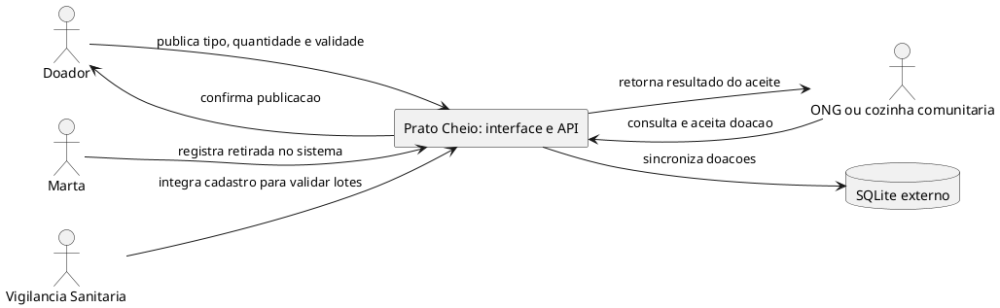

# Registro da revisão com IA de diagramas

## Geração inicial

Ferramenta: ChatGPT (modelo de linguagem usado nesta tarefa).

Prompt enviado: “Com base na descrição do caso Prato Cheio: doadores publicam excedentes, ONGs e cozinhas consultam e aceitam ofertas, Marta acompanha retiradas durante o piloto, e a Vigilância Sanitária exige rastreabilidade mínima. Gere uma primeira versão PlantUML de diagrama de contexto. Inclua o banco de dados e os participantes que considerar pertinentes.”

A resposta abaixo foi preservada como gerada, antes da comparação e das correções:

## Comparação com análise e repositório

A descrição candidata foi confrontada com `docs/analise.md`, especialmente RN-01 a RN-05, a história zero, os critérios CA-01 a CA-05, o experimento do piloto e as limitações da decisão de análise. A análise define publicar, listar e aceitar como fatia desta iteração e informa que retirada física não é registrada pelo produto. O registro de uso de IA em `docs/projeto.md` informa que a revisão humana da contribuição integrada continua pendente; portanto, este registro não declara aprovação humana.

| Trecho da geração inicial | Fonte que contradiz | Correção aplicada no diagrama final |
|---|---|---|
| `Marta --> PC : registra retirada no sistema` | `docs/analise.md`, seção “Hipótese e experimento”: Marta acompanha publicação, validade, aceite e confirmação da retirada em planilha, pois o sistema ainda não registra retirada. `public/app.js` implementa publicação, consulta e aceite; não registra retirada. | Marta não foi mostrada como ator que troca informação com o sistema. O texto de `docs/diagramas/contexto.md` explicita acompanhamento em planilha externa, sem integração. |
| `database "SQLite externo" as DB` e `PC --> DB : sincroniza doacoes` | `src/db.js` cria e conecta a tabela SQLite como persistência usada pelo produto; `src/repositorio.js` faz consultas e atualizações nessa conexão. Não há sistema externo nem sincronização. | SQLite não aparece como sistema externo no diagrama. O texto final o identifica como persistência interna. |
| `VS --> PC : integra cadastro para validar lotes` | `docs/analise.md`, seção “Conflitos de prioridade”, registra a exigência de rastreabilidade mínima e define tipo, quantidade e validade como obrigatórios. `src/app.js` e `public/app.js` não implementam integração com a Vigilância. | A seta tracejada no diagrama final é rotulada “exige rastreabilidade mínima” e o texto esclarece que representa requisito, não integração automática. |

## Estado da confirmação do grupo

**Confirmação humana pendente.** Ainda não foi possível pedir a um integrante identificado que confirme esta comparação. A análise acima é uma revisão da IA, não uma revisão do grupo. Solicitação a registrar com um integrante: “Você confirma que os três trechos apontados estão contraditos pelas fontes citadas e que as correções refletem o escopo aprovado da análise?” Registrar nome, resposta e data após a confirmação; não alterar este estado antes de ela ocorrer.
