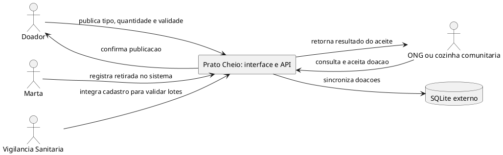

# Registro da revisão com IA de diagramas

Referência: atividade em grupo **Modelagem do sistema**, organizada em diagrama de contexto, modelo de dados e revisão usando IA. O diagrama escolhido para a revisão com IA foi o **contexto**. A atividade pede pelo menos dois erros ou inconsistências na versão gerada; os três encontrados estão registrados abaixo.

## Geração inicial

Ferramenta: ChatGPT (modelo de linguagem usado nesta tarefa).

Prompt enviado: “Com base na descrição do caso Prato Cheio: doadores publicam excedentes, ONGs e cozinhas consultam e aceitam ofertas, Marta acompanha retiradas durante o piloto, e a Vigilância Sanitária exige rastreabilidade mínima. Gere uma primeira versão PlantUML de diagrama de contexto. Inclua o banco de dados e os participantes que considerar pertinentes.”

A resposta abaixo foi preservada como gerada, antes da comparação e das correções:

## Comparação com a análise do grupo e o código

A versão inicial foi comparada à [Análise do grupo](../analise.md), especialmente RN-01 a RN-05, a história zero, os critérios CA-01 a CA-05, o experimento do piloto e as limitações da decisão de análise. O escopo implementado é publicar, consultar e aceitar; a retirada física é acompanhada fora do produto. A conferência técnica também usou `src/db.js`, `src/repositorio.js`, `src/app.js` e `public/app.js`.

| Trecho da geração inicial | Fonte que contradiz | Correção aplicada no diagrama final |
|---|---|---|
| `Marta --> PC : registra retirada no sistema` | `docs/analise.md`, seção “Hipótese e experimento”: Marta acompanha publicação, validade, aceite e confirmação da retirada em planilha, pois o sistema ainda não registra retirada. `public/app.js` implementa publicação, consulta e aceite; não registra retirada. | Marta não foi mostrada como ator que troca informação com o sistema. O texto de `docs/diagramas/contexto.md` explicita acompanhamento em planilha externa, sem integração. |
| `database "SQLite externo" as DB` e `PC --> DB : sincroniza doacoes` | `src/db.js` cria e conecta a tabela SQLite como persistência usada pelo produto; `src/repositorio.js` faz consultas e atualizações nessa conexão. Não há sistema externo nem sincronização. | SQLite não aparece como sistema externo no diagrama. O texto final o identifica como persistência interna. |
| `VS --> PC : integra cadastro para validar lotes` | `docs/analise.md`, seção “Conflitos de prioridade”, registra a exigência de rastreabilidade mínima e define tipo, quantidade e validade como obrigatórios. `src/app.js` e `public/app.js` não implementam integração com a Vigilância. | A Vigilância permanece no contexto, com a exigência em uma nota e sem seta para o sistema. Assim, o requisito não é representado como troca de dados ou integração automática. |

## Diagramas finais e conferência da atividade

Entrega: [diagrama de contexto](../diagramas/contexto.md), [modelo de dados](../diagramas/dados.md) e a indicação dos erros na tabela acima. Os dois diagramas incluem imagem para leitura direta e a fonte PlantUML.

| Etapa e item pedido | Evidência no resultado final |
|---|---|
| 1. Sistema como uma única caixa | O contexto contém uma caixa chamada Prato Cheio. |
| 1. Principais atores, fronteira e interações | Doador publica; ONG ou cozinha comunitária consulta e aceita. SQLite é interno. A Vigilância é origem de requisito, em nota sem fluxo de dados; Marta acompanha a retirada em planilha externa, sem integração. |
| 1. Informações que entram e saem nas setas | Publicação com tipo, quantidade e validade; consulta de disponíveis e sua lista; aceite com identificador da doação e nome da ONG; respostas de sucesso ou mensagem de erro. |
| 2. Entidades, relacionamentos e atributos | Uma entidade `doacoes`, sete atributos e nenhuma chave estrangeira ou relacionamento entre tabelas. `ong` é texto. Tipos, nulabilidade e padrões conferem com `src/db.js`. |
| 2. Atributos ligados às regras de negócio | `tipo`, `quantidade` e `validade` sustentam RN-01; `status` e `ong` sustentam disponibilidade e aceite exclusivo, RN-02/RN-03. |
| 2. Transição do aceite e estados | Tabela de estados no modelo: `disponivel` e `ong=NULL` antes; `aceita` e nome da ONG depois. Segundo aceite recusado, com preservação da primeira ONG. O `UPDATE` condicional protege requisições concorrentes. |
| 3. Versão da IA, comparação, erros explicados e correção | Prompt e versão inicial preservados; três erros explicados com suas fontes; os três corrigidos no contexto final. |

## Tratamento dos apontamentos da outra revisão

Os rótulos genéricos foram substituídos por informações concretas nas seis setas. A exigência da Vigilância foi movida para uma nota, mantendo esse participante sem sugerir uma integração implementada.

O grupo conferiu pessoalmente as fontes citadas, comparando a versão gerada pela IA com a análise do grupo e o código do repositório. A conferência abrangeu os três erros identificados e as respectivas correções no diagrama final.

As ressalvas técnicas são: retirada permanece fora do produto; `ong` não representa uma entidade cadastrada; o modelo reproduz os estados e restrições implementados, sem acrescentar políticas de reoferta ou novas funcionalidades.

## Validação técnica — 22/10/2026

`npm test`: 15 testes passaram, incluindo publicação, aceite exclusivo e isolamento do banco. Os dois blocos PlantUML passaram por verificação de sintaxe e renderização com PlantUML 1.2026.9; as imagens foram inspecionadas visualmente. A estrutura do banco foi conferida com `PRAGMA table_info(doacoes)`, `PRAGMA foreign_key_list(doacoes)` e o schema criado por `migrar()`, usando banco em memória.

As imagens podem ser atualizadas com `npm run docs:diagramas -- "caminho/para/plantuml.jar"`, conforme o README.
