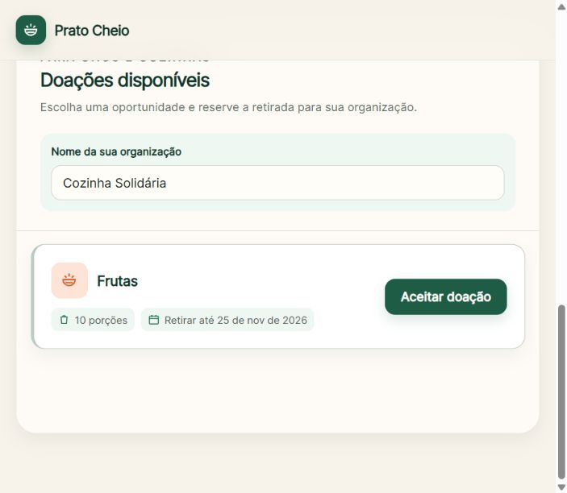

# Validação técnica da Aula 13 — 24/11/2026

Responsável: André Schultz. Execução assistida pelo Codex, a seu pedido, em 24/11/2026; não é um registro de reprodução manual independente por outro integrante.

## Ambiente e origem

- Clone novo da branch `docs/entrega-aula-13`, commit `8d6e5fd145638d1e6eb9d0972ec4fcf479731820`.
- Windows, Node.js 22.14.0, dependências instaladas por `npm ci` a partir do lockfile.
- PostgreSQL 18.3 local, em `127.0.0.1:55432`, criado exclusivamente para esta validação; bancos `pr11_demo` e `pr11_testes` separados. Nenhuma conexão ao banco do piloto.
- Aplicação em `http://localhost:3101` com `PORT=3101`. O CI do mesmo commit usou PostgreSQL 16: [execução 44613122929](https://github.com/CodePenguinsCorp/prato-cheio/actions/runs/44613122929).

## Testes automatizados

Com as variáveis apontando para os bancos descartáveis, foram executados `npm ci`, `npm run db:migrar` e `npm test`. A migração imprimiu `schema criado`; a suíte terminou com código 0:

```text
tests/doacoes.test.js       14 tests
tests/banco-seguro.test.js   1 test
Test Files  2 passed (2)
Tests      15 passed (15)
```

## Demo executada

| Passo | Verificação e resultado observado |
|---|---|
| 1 | Interface abriu com lista vazia e contador 0. |
| 2 e 3 | Publicadas Pães/20 unidades e Frutas/10 porções, com validade 25/11/2026. Ambas apareceram e o contador chegou a 2. |
| 4 | Tentativa de publicar Arroz sem quantidade mostrou “Informe a quantidade disponível.”; nenhuma terceira doação foi criada. |
| 5 | Cozinha Solidária aceitou Pães; o cartão saiu da lista, Frutas permaneceu e o contador passou a 1. |
| 6 | Segundo aceite de Pães por Outra ONG retornou HTTP 400 e `{"erro":"doação já foi aceita"}`. |
| 7 | Publicação sem validade retornou HTTP 400 e `{"erro":"validade é obrigatório"}`. |
| 8 | `GET /api/saude` retornou HTTP 200 e `{"ok":true}`. |
| 9 | Suíte completa: 15 testes passando no banco `pr11_testes`, sem alterar os dados da demo. |

Após as verificações, uma consulta SQL ao banco `pr11_demo` confirmou:

| id | tipo | status | ong |
|---:|---|---|---|
| 1 | Pães | aceita | Cozinha Solidária |
| 2 | Frutas | disponivel | NULL |



## Correções e limites

O roteiro passou a aguardar a prontidão do PostgreSQL, separar o banco dos testes, usar `npm ci` e explicitar a configuração por terminal. Foram corrigidas as seções de validação, contribuição e uso de IA. Não foi necessário alterar a aplicação.

A reprodução manual independente por outro integrante permanece pendente. Não foram validados o piloto, o uso em conexão instável, a confirmação física de retirada nem a meta de 70% de retiradas.
