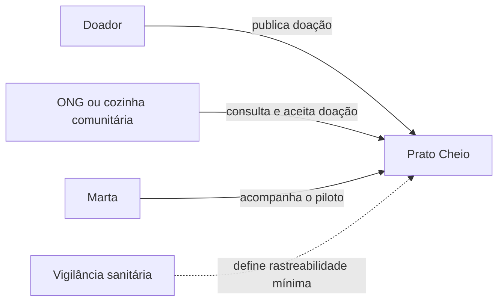
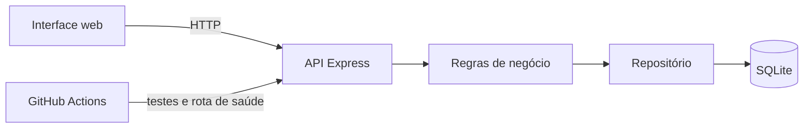

# Documento de Projeto — Prato Cheio

*Trabalho 2 · máximo 4 páginas (fora diagramas) · entrega na Aula 10*

## Decisões de projeto

| # | Decisão | Alternativa A | Alternativa B | Escolha | Requisito ou risco da Unidade 1 |
|:--:|---|---|---|---|---|
| D1 | Como impedir que duas ONGs reservem a mesma doação? | Fazer uma atualização condicional e atômica no banco (`UPDATE ... WHERE status = 'disponivel'`). | Abrir uma transação com bloqueio de escrita, reler o estado e então atualizar. | **A**, por preservar a regra em uma única operação, funcionar no SQLite e exigir menos coordenação da aplicação. | **RN-02, RN-03 e CA-05:** uma doação aceita deixa de estar disponível e não pode ter um segundo aceite. |
| D2 | Onde garantir os três dados mínimos da publicação? | Validar tipo, quantidade e validade na camada de negócio; o front-end pode repetir a validação apenas para resposta rápida. | Usar restrições no banco e converter os erros na camada HTTP. | **A**, porque mantém a regra independente da interface e produz mensagens úteis sem acoplar o comportamento ao banco. Restrições simples no schema continuam como defesa adicional. | **RN-01 e CA-02**, além do risco “doador abandonar um cadastro demorado”: só os três campos mínimos bloqueiam a publicação. |
| D3 | Como tratar uma doação aceita que não foi retirada? | Registrar manualmente a ocorrência e manter a doação fora da lista até decisão da Marta, sem reoferta automática. | Expirar a reserva após um prazo configurado e recolocar a doação automaticamente na lista. | **A, provisoriamente**, até o piloto fornecer prazo seguro e autorização operacional; a decisão deve ser revista com Marta e as ONGs. | **RN-04, RN-05** e risco “doação ser aceita e não retirada no prazo” (probabilidade e impacto altos). |

As três decisões têm registro detalhado em [`docs/adr/`](adr/):

- [ADR 0001 - aceite atômico](adr/0001-aceite-atomico.md);
- [ADR 0002 - validação dos dados mínimos](adr/0002-validacao-dados-minimos.md);
- [ADR 0003 - doação aceita e não retirada](adr/0003-doacao-nao-retirada.md).

## Tabela de trade-offs - D1: concorrência no aceite

Escala: **1 (pior) a 5 (melhor)**. Os pesos refletem o impacto das RN-02/RN-03: correção concorrente é mais importante que conveniência de implementação. A pontuação ponderada é `nota × peso`.

| Critério | Peso | A - atualização condicional atômica | B - transação com bloqueio |
|---|:--:|:--:|:--:|
| Garante um único vencedor sob concorrência | 5 | 5 - a condição é verificada na própria escrita | 5 - o bloqueio serializa os concorrentes |
| Simplicidade de implementação e revisão | 3 | 5 - uma instrução SQL | 2 - exige início, commit, rollback e tratamento do bloqueio |
| Compatibilidade com SQLite e futura migração para PostgreSQL | 3 | 5 - ambos aceitam a atualização condicional | 3 - os mecanismos de bloqueio diferem entre os bancos |
| Tempo de bloqueio e contenção | 2 | 5 - bloqueio restrito à atualização | 2 - a transação mantém o bloqueio por mais tempo |
| Clareza do resultado para a API | 2 | 5 - linha retornada significa sucesso; ausência significa conflito | 4 - é preciso distinguir estado inválido, timeout e conflito |
| **Total ponderado** |  | **75/75** | **52/75** |

**Decisão:** adotar A. A consulta prévia pode continuar existindo para diferenciar “não encontrada” de “já aceita”, mas não é a garantia de exclusão mútua; essa garantia pertence ao `UPDATE` condicional. O teste concorrente `EX-02` deve continuar executando no CI para detectar regressões.

## Diagramas

### Contexto

### Componentes

## ADRs

Os ADRs 0001 a 0003 registram contexto, alternativas, decisão, consequências e rastreabilidade até a Unidade 1. O arquivo `0000-modelo-adr.md` permanece como modelo para decisões futuras.

## Requisitos não-funcionais

| Requisito | Como afeta o design |
|---|---|
| Consistência sob concorrência | O aceite usa escrita condicional atômica e mantém o teste `EX-02` no CI. |
| Facilidade de uso no celular | O cadastro mantém somente tipo, quantidade e validade como campos obrigatórios. |
| Evolução do banco | O acesso a dados permanece isolado em `src/repositorio.js` e `src/db.js`, reduzindo o impacto da migração futura para PostgreSQL. |
| Auditabilidade das mudanças | A `main` está protegida e recebe mudanças por Pull Request com CI verde e revisão. A evidência fica em [`docs/evidencias/protecao-main.md`](evidencias/protecao-main.md). |

## Critérios de validação do projeto

- `CA-02`: publicação sem qualquer um dos três campos mínimos retorna erro e não persiste a doação.
- `CA-05` e `EX-02`: entre dois aceites para a mesma doação, inclusive simultâneos, exatamente um tem sucesso.
- Para D3, registrar no piloto quantas doações aceitas não são retiradas e em quanto tempo; só então decidir se há base para expiração automática.
- O pipeline executa `npm test` e verifica a rota `/api/saude` em todo Pull Request.

## Uso de IA

A IA apoiou a organização das alternativas e da matriz de trade-offs. O grupo revisou a rastreabilidade, as notas, os pesos e a decisão provisória D3 em relação à análise da Unidade 1.
